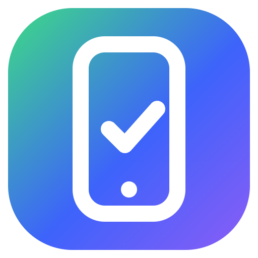
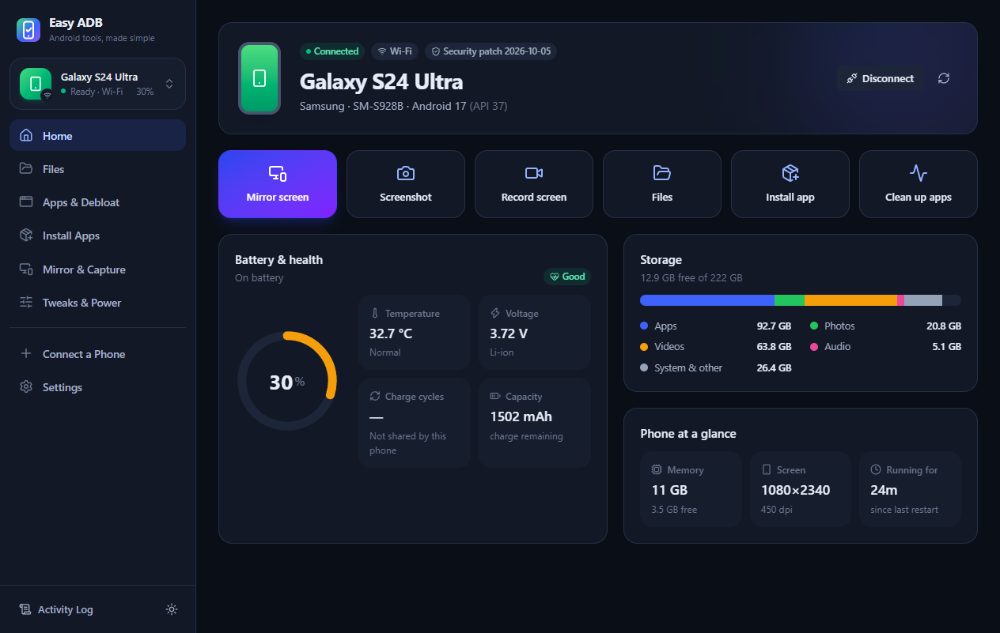
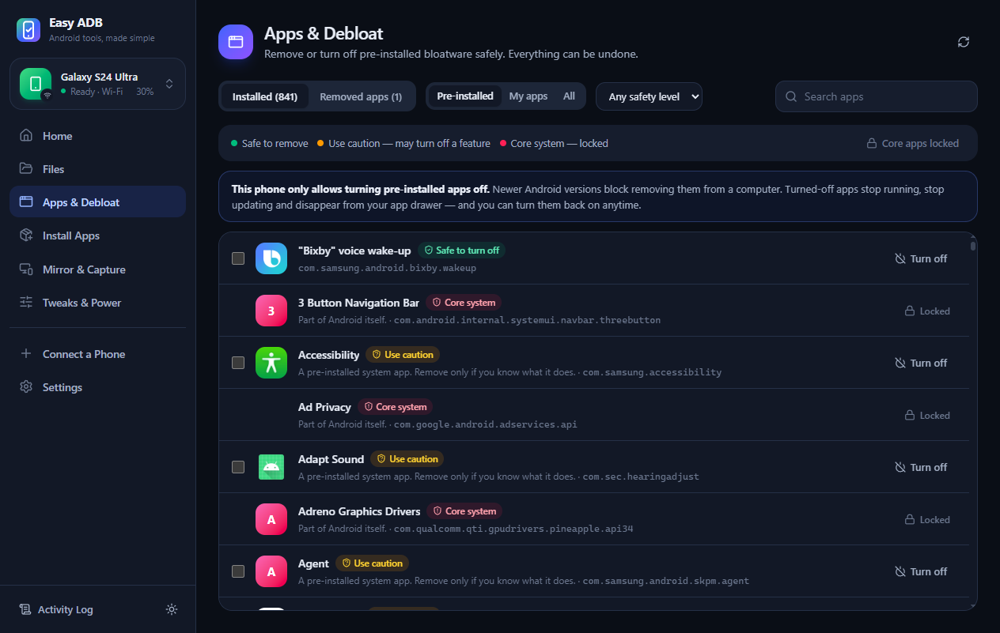
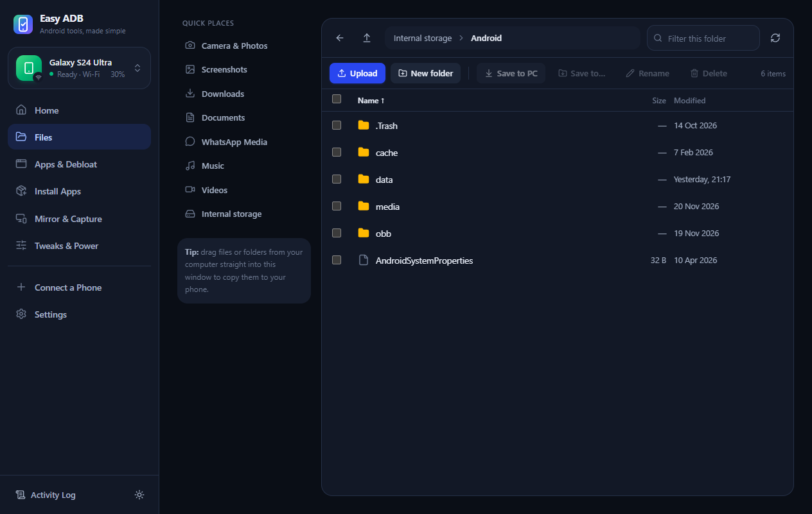
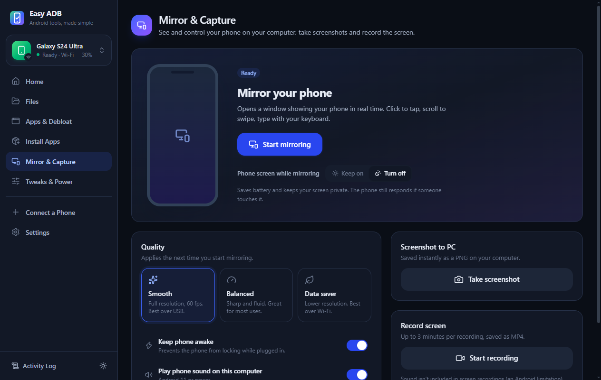
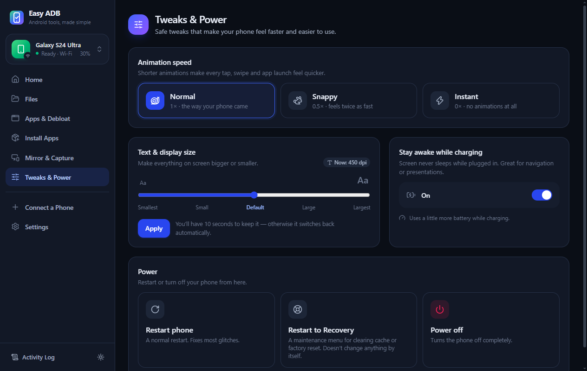
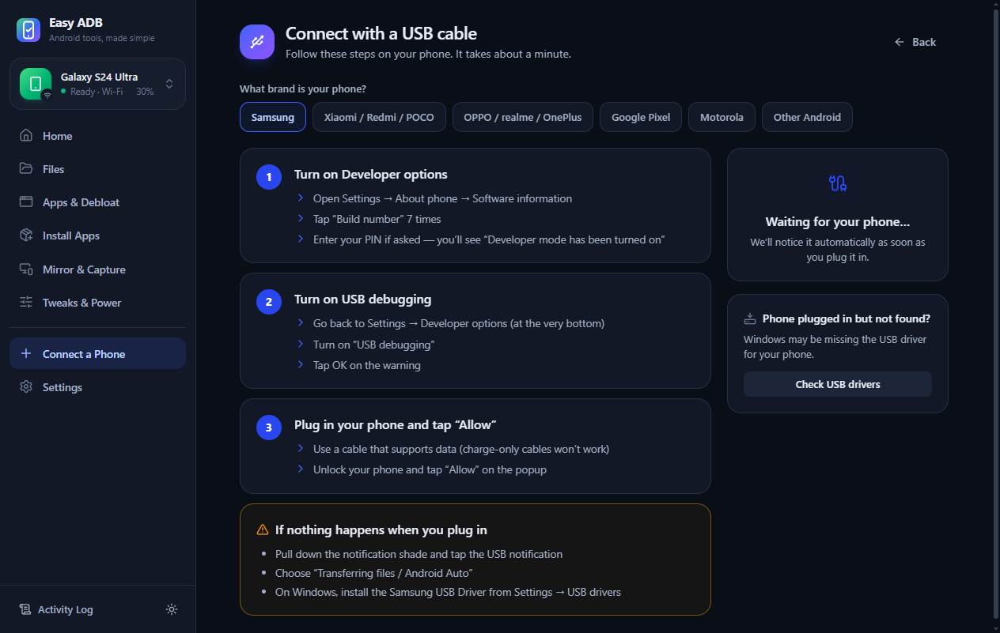

<div align="center">



# Easy ADB

**Everyday Android power tools with zero setup.**<br/>
Copy files, clean up bloatware, install split APK bundles, mirror your screen and more,<br/>
without installing SDKs, editing `PATH` or opening a terminal.

[](https://github.com/aboayman-oss/easy-adb/actions/workflows/ci.yml)
[](https://github.com/aboayman-oss/easy-adb/releases/latest)
[](https://github.com/aboayman-oss/easy-adb/releases)
[](LICENSE)




</div>

## Download

Grab the latest version from the [**Releases page**](https://github.com/aboayman-oss/easy-adb/releases/latest):

| | File | Best for |
|---|---|---|
| **Installer** | `Easy-ADB-Setup-<version>.exe` | Most people. Installs for your Windows account only (no admin rights), adds Start-menu and desktop shortcuts, and can be removed from *Settings → Apps*. |
| **Portable** | `Easy-ADB-Portable-<version>.zip` | USB sticks and locked-down PCs. Unzip anywhere and run `Easy ADB.exe`. Settings and the Android tools stay in an `Easy ADB Data` folder inside, so nothing is written to AppData. |

On first launch Easy ADB downloads Google's official Android platform-tools and scrcpy (about 40 MB), checks their checksums, and is ready to go. You never have to do it again.

> [!NOTE]
> Easy ADB isn't code-signed yet, so Windows SmartScreen may say *"Windows protected your PC"*. Click **More info → Run anyway**. The app is built from this repository by [GitHub Actions](https://github.com/aboayman-oss/easy-adb/actions/workflows/release.yml).

**Requirements:** Windows 10 or 11 (64-bit) and an Android phone. USB works with any Android version that has USB debugging. Wireless pairing needs Android 11 or newer.

## Features

| | |
|---|---|
| **Zero-setup engine** | On first launch, downloads Google's official platform-tools and scrcpy into the app-data folder, verifies their checksums, and tests both. *Settings → Engine* checks for updates and can repair the engine. |
| **Connection hub** | Live device tracking with clear states for *no phone*, *waiting for "Allow"* and *offline*. On Windows it notices a phone that is plugged in with USB debugging still off and shows that brand's steps to turn it on (Samsung, Xiaomi/Redmi/POCO, OPPO/realme/OnePlus, Pixel, Motorola). Includes a USB driver check and one-click Google USB driver install. Short drops show a "Reconnecting…" note instead of kicking you out. |
| **Wi-Fi** | QR-code pairing (Android 11+), a 6-digit pairing-code option, and "Go wireless" for phones on a cable. Phones connected over Wi-Fi are remembered and reconnect by themselves, even after their port changes. |
| **Files** | A visual explorer with shortcuts (Camera, Screenshots, Downloads, WhatsApp Media…), drag-and-drop upload of files and folders, and download to the PC. A transfer tray shows progress, speed, time left and Cancel. Half-copied files are cleaned up if a transfer is cancelled or the phone disconnects. Arabic and other Unicode file names work. |
| **Apps & Debloat** | Real app names and icons, color-coded safety ratings (Safe / Use caution / Core system, with core apps locked), Remove / Turn off / Uninstall, and a *Removed apps* tab with one-click Restore. On Android versions that block removing system apps over USB, Easy ADB switches to "Turn off" automatically. |
| **Install** | Drop in `.apk`, `.xapk`, `.apks` or `.apkm` files. Split APKs are matched to your phone, OBB game data is copied, and install errors are explained in plain language. |
| **Mirror & Capture** | One-click screen mirroring (scrcpy) with Smooth / Balanced / Data saver presets, a *Keep on / Turn off* choice for the phone's own screen, phone audio on the PC, and always-on-top. Screenshots and screen recordings (up to 3 minutes) save straight to the PC. |
| **Device health** | Battery level, health, temperature, voltage, charge cycles and capacity (when the phone shares them), storage breakdown, RAM, screen and uptime. |
| **Tweaks & Power** | Animation speed presets, a display size slider that switches back automatically after 10 seconds unless you keep it, stay-awake-while-charging, and Restart / Recovery / Power off with plain explanations. |
| **Activity Log** | Every command Easy ADB ran, how long it took and what happened, in plain words. Wi-Fi pairing codes are hidden. |

Dangerous features (flashing, bootloader unlocking, raw shell access, deleting outside user storage) are intentionally left out so your phone stays safe. See [PRODUCT_SPEC.md](PRODUCT_SPEC.md) for the full capability audit.

<details>
<summary><b>More screenshots</b></summary>
<br/>

| Apps & Debloat | Files |
|---|---|
|  |  |

| Mirror & Capture | Tweaks & Power |
|---|---|
|  |  |

| USB setup guide | |
|---|---|
|  | |

</details>

## Privacy

Easy ADB has no accounts, telemetry or ads. It only talks to the internet to download the official tools (from `dl.google.com` and scrcpy's GitHub releases) and, if you ask it to, the Google USB driver. Everything else happens between your PC and your phone.

## Troubleshooting

- **Phone not showing up over USB.** Make sure *USB debugging* is on, use a cable that carries data, unlock the phone and tap **Allow**. Easy ADB tells you if Windows sees the phone but USB debugging is off, or if a driver is missing.
- **"Waiting for Allow".** Unlock the phone, tick *Always allow from this computer* and tap **Allow**.
- **Wi-Fi pairing doesn't find the phone.** The PC and phone must be on the same network, and some guest or office networks block device discovery. Use the pairing-code option, or connect once with USB and press **Go wireless**.
- **Something else.** Open the **Activity Log** (bottom-left) to see what happened, then [open an issue](https://github.com/aboayman-oss/easy-adb/issues/new/choose).

## Development

Built with Electron, React 19, TypeScript, Tailwind CSS 4 and electron-vite. Requires Node.js 20 or newer (CI uses 22).

```powershell
npm ci
npm run dev           # run with hot reload
npm test              # unit tests (vitest)
npm run typecheck     # main + renderer TypeScript checks
npm run verify        # typecheck + tests + production build
npm run dist          # installer + portable zip in dist/
```

`EASY_ADB_ENGINE_DIR` can point the app at a different engine folder during development.

```
src/
  shared/        IPC contract + domain types (used by every process)
  main/
    engine/      download, verify, extract and update platform-tools + scrcpy
    adb/         runner, device tracker, sync protocol, files, apps, installer,
                 mirroring, capture, tweaks, wireless pairing
    lib/         pure, unit-tested logic (escaping, parsers, QR, APK/ARSC readers…)
    data/        package safety dictionary
    platform/    Windows USB detection and driver helper
    portable.ts  portable mode (data next to the app)
  preload/       contextBridge (sandboxed)
  renderer/      React + Tailwind UI
tests/           vitest suites
```

Releases are built by GitHub Actions: push a `v*` tag and the [release workflow](.github/workflows/release.yml) builds the installer and portable zip and attaches them to a GitHub release.

## Contributing

Bug reports and ideas are welcome in [Issues](https://github.com/aboayman-oss/easy-adb/issues). For code changes, open a pull request and make sure `npm run verify` passes. If you're adding a phone brand's setup steps or a package to the safety list, mention the phone model and Android version you tested on.

## Acknowledgements

- [Android SDK Platform-Tools](https://developer.android.com/tools/releases/platform-tools) by Google, downloaded at first launch.
- [scrcpy](https://github.com/Genymobile/scrcpy) by Genymobile (Apache 2.0), downloaded at first launch.

Easy ADB is an independent project and isn't affiliated with Google, Samsung or any phone maker.

## License

[MIT](LICENSE)
